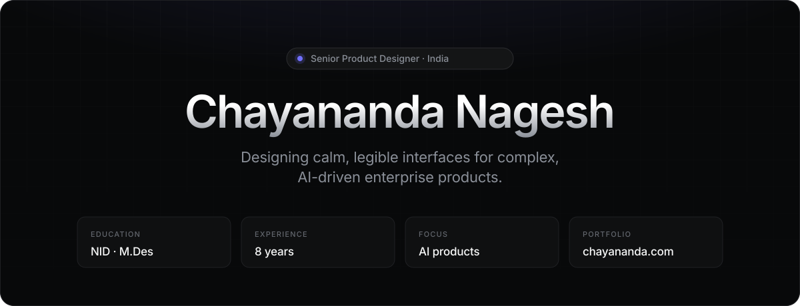
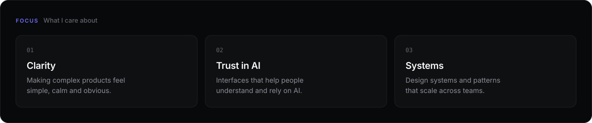
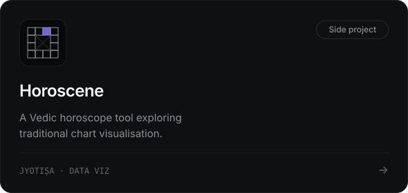
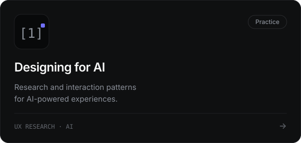
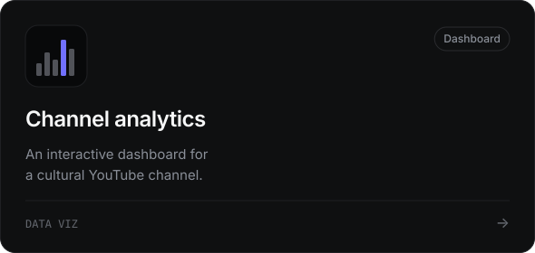
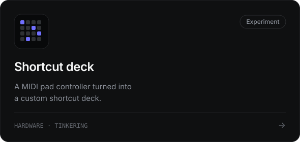
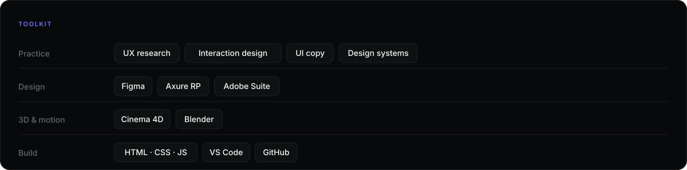
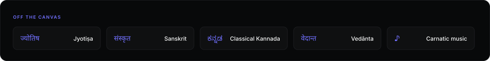

<a href="https://chayananda.com">
  <picture>
    <source media="(prefers-color-scheme: dark)" srcset="assets/hero-dark.svg">
    <source media="(prefers-color-scheme: light)" srcset="assets/hero-light.svg">
    
  </picture>
</a>

 

I’m a product designer with 8 years of experience across UX research, interaction design, UI copy and design systems, with a Master’s in Design from the **National Institute of Design**. I focus on making complex, AI-driven products feel clear and trustworthy.

 

<picture>
  <source media="(prefers-color-scheme: dark)" srcset="assets/focus-dark.svg">
  <source media="(prefers-color-scheme: light)" srcset="assets/focus-light.svg">
  
</picture>

  

<a href="https://chayananda.com"><picture><source media="(prefers-color-scheme: dark)" srcset="assets/card-1-dark.svg"><source media="(prefers-color-scheme: light)" srcset="assets/card-1-light.svg"></picture></a>
<a href="https://chayananda.com"><picture><source media="(prefers-color-scheme: dark)" srcset="assets/card-2-dark.svg"><source media="(prefers-color-scheme: light)" srcset="assets/card-2-light.svg"></picture></a>
<a href="https://chayananda.com"><picture><source media="(prefers-color-scheme: dark)" srcset="assets/card-3-dark.svg"><source media="(prefers-color-scheme: light)" srcset="assets/card-3-light.svg"></picture></a>
<a href="https://chayananda.com"><picture><source media="(prefers-color-scheme: dark)" srcset="assets/card-4-dark.svg"><source media="(prefers-color-scheme: light)" srcset="assets/card-4-light.svg"></picture></a>

  

<picture>
  <source media="(prefers-color-scheme: dark)" srcset="assets/toolkit-dark.svg">
  <source media="(prefers-color-scheme: light)" srcset="assets/toolkit-light.svg">
  
</picture>

  

<picture>
  <source media="(prefers-color-scheme: dark)" srcset="assets/offcanvas-dark.svg">
  <source media="(prefers-color-scheme: light)" srcset="assets/offcanvas-light.svg">
  
</picture>

  

  <a href="https://chayananda.com"><b>chayananda.com</b></a>
  &nbsp;&nbsp;·&nbsp;&nbsp;
  <a href="https://linkedin.com/in/chayananda">LinkedIn</a>
  &nbsp;&nbsp;·&nbsp;&nbsp;
  <a href="mailto:hello@chayananda.com">hello@chayananda.com</a>

